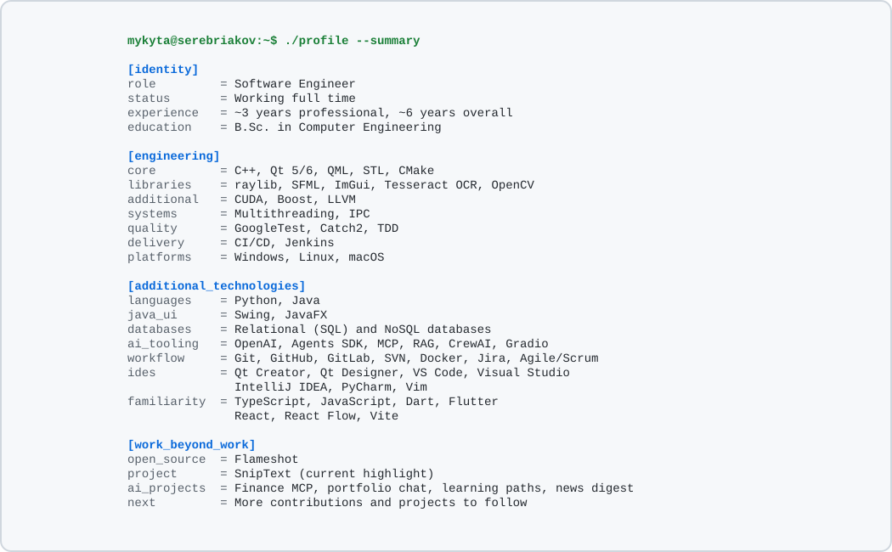

<h1>Hello, I am Mykyta</h1>

  
  
  

## About Me

I work full time as a software engineer at [GeoSoftware](https://www.geosoftware.com/), building and maintaining C++/Qt desktop software with CMake-based build systems, careful debugging, and clean desktop application architecture.

I have about 3 years of professional software engineering experience and around 6 years of programming experience overall. I am a self-taught programmer with a bachelor's degree in Computer Engineering, and I keep learning by building practical projects across C++, Python, AI automation, and developer tooling.

In my free time, I like contributing to open-source projects and helping other people where I can, especially around desktop UX, debugging, and improvements that make software easier to use and maintain.

## Engineering Profile

<picture>
  <source media="(prefers-color-scheme: dark)" srcset="./assets/profile-card-dark.svg" />
  
</picture>

## Open Source

- [Flameshot](https://github.com/flameshot-org/flameshot): cross-platform screenshot software built with C++ and Qt. You can see my Flameshot pull requests [here](https://github.com/pulls?q=is%3Apr+author%3Aserebryakov02+repo%3Aflameshot-org%2Fflameshot).

I am actively building my open-source contribution record, and this section will grow as more work is reviewed and merged. You can see all my visible pull requests [here](https://github.com/pulls?q=is%3Apr+author%3Aserebryakov02).

## Current Direction

Right now I am focused on growing as a C++/Qt software engineer, contributing more to open source, and building useful Python-based AI tools.
